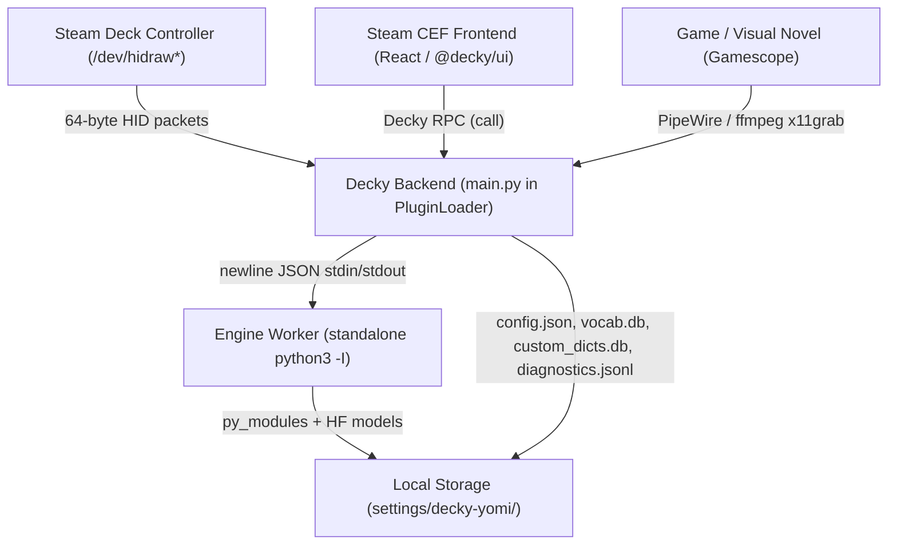
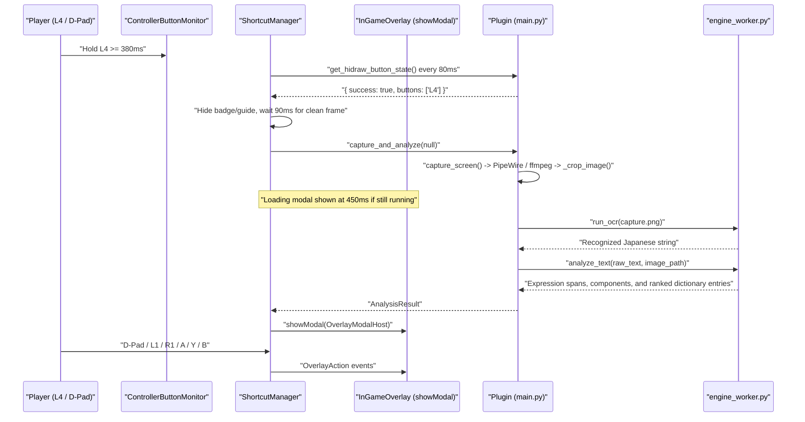

# Decky Yomi Architecture (HLD & LLD)

This document covers the high-level system architecture and low-level module design of Decky Yomi.

---

## 1. High-Level Design (HLD)

Decky Yomi runs across three isolated execution boundaries on SteamOS:

1. **Steam CEF UI (`src/`)**: TypeScript/React bundle loaded by Decky Loader inside Steam's Chromium Embedded Framework (`SP` / QAM). It renders both the Quick Access Menu panel and the global in-game overlay.
2. **Decky Plugin Backend (`main.py`)**: Python async backend hosted inside Decky's frozen `PluginLoader` process (PyInstaller). Handles configuration, SQLite persistence, screen capture, hardware button polling, and dependency management.
3. **Standalone Engine Worker (`backend/engine_worker.py`)**: A separate `/usr/bin/python3 -I` child process that isolates heavy ML/NLP dependencies (`meikiocr`, `onnxruntime`, `manga-ocr`, `torch`, `fugashi`, `jamdict`) installed in `~/homebrew/settings/decky-yomi/py_modules` from Decky's frozen runtime.

### Key Design Decisions

- **Worker isolation (`engine_worker.py`)**: Decky's `PluginLoader` runs as a frozen binary whose `sys.executable` points to `PluginLoader` rather than system Python. Running `MeikiOCR`, `MangaOcr`, `fugashi`, and `jamdict` inside a dedicated `/usr/bin/python3 -I` subprocess avoids ABI/library collisions and keeps `PluginLoader` startup fast.
- **Private installer environment**: Dependency installation bootstraps a private `venv`/`ensurepip` (`installer-venv`) using `/usr/bin/python3 -I` with `TMPDIR` inside `~/homebrew/settings/decky-yomi/installer-tmp`, preventing RAM-backed `/tmp` exhaustion.
- **Hardware HID shortcut polling**: Steam consumes controller events before browser listeners see them during gameplay, so `ControllerButtonMonitor` reads raw HID packets directly from `/dev/hidraw*` (`:1.2` interface) to detect rear grip holds (`L4`/`R4`/`L5`/`R5`).
- **Native modal input trapping**: When the interactive overlay opens, `InGameOverlay` opens a native Steam `showModal` (`ModalRoot` + `Focusable`) on `GamepadUI_Full_Root` (`SP`), keeping `ABXY` and D-Pad presses inside the overlay rather than forwarding them to the game underneath.

---

## 2. Low-Level Design (LLD)

### 2.1 Capture, OCR, and Lookup Sequence

### 2.2 Frontend Components (`src/`)

| File | Responsibility |
| --- | --- |
| `src/index.tsx` | Registers QAM panel (`MainPanel`), global overlay (`routerHook.addGlobalComponent("DeckyYomiOverlay", InGameOverlay)`), diagnostics, and `shortcutManager.start()`. |
| `src/utils/shortcutManager.ts` | Polls `get_hidraw_button_state` every `80ms`; manages `L4` hold trigger (`380ms`), `regionPreview` timer (`4.5s` or pinned), `30s` inactivity auto-dismiss, and edge-triggered/repeat `OverlayAction` dispatch (`prev_word`, `next_word`, `prev_defined`, `next_defined`, `prev_entry`, `next_entry`, `save_word`, `recapture`, `dismiss`). |
| `src/components/InGameOverlay.tsx` | Renders `#decky-yomi-region-guide` (`UIComposition.Notification`) and the holding badge; opens Steam's `showModal` (`ModalRoot` + `Focusable`) with `OverlayResultsCard` when `state.visible` is true. |
| `src/components/MainPanel.tsx` | 2-column QAM navigation (`OCR`, `Results`, `Vocab`, `Settings`, `Setup`), engine readiness banner, and toast notifications. |
| `src/components/OCRPanel.tsx` | Region preset dropdown, manual capture trigger, preview guide trigger, and manual Japanese text lookup (`analyze_text`). |
| `src/components/SettingsPanel.tsx` | Configures `ocr_engine` (`meikiocr` / `manga_ocr`), `hotkey_trigger`, region presets, custom box sliders (`X`, `Y`, `W`, `H`) with 16:10 mini-preview and screen helper toggle, display toggles, and Yomitan `.zip` import. |
| `src/components/DictionaryResults.tsx` | Word-by-word cards inside QAM with readings, POS badges, `KanjiDetail`, and deduplicated `save_word`. |
| `src/components/VocabList.tsx` | Paginated (`50` per page) vocabulary browser with delete and `.tsv` export. |
| `src/components/DownloadManager.tsx` | Polls `get_components_status` (`1.5s` interval while installing), shows progress/logs, and triggers `start_install` / `cancel_install`. |
| `src/utils/diagnostics.ts` | Wraps `@decky/api` `call` with timed RPC tracing, localStorage breadcrumb buffer (`max 100`), error/rejection listeners, and batched `log_frontend` flushing every `2s`. |

### 2.3 Backend Modules (`main.py` & `backend/`)

#### Screen Capture (`main.py`)
`capture_screen(region)` resolves `region` from `get_configured_region()` if `None`, then tries capture providers in order:
1. `_capture_pipewire`: `gst-launch-1.0 -e pipewiresrc do-timestamp=true num-buffers=5 ! videoconvert ! pngenc snapshot=true ! filesink location=...` (with `runuser -u deck --` when UID is `0` and `XDG_RUNTIME_DIR=/run/user/1000`).
2. `_capture_ffmpeg`: iterates `_get_candidate_displays()` (`:1` first for game display, then `:2..:5`, then `:0`).
3. `_capture_grim` and `_capture_spectacle` fallbacks.

`_crop_image(path, region)` converts percentage (`0..100`) or pixel coordinates to clamped `(x, y, w, h)` bounds and saves in-place via Pillow.

#### OCR Dispatch & Splitting (`main.py`, `backend/engine_worker.py`)
`engine_worker.py` communicates over newline-delimited JSON on `stdin`/`stdout` (redirecting `stdout` to `stderr` so library logs never corrupt protocol JSON). Allowed methods: `_init_engines`, `get_engine_status`, `run_ocr`, `analyze_text`, `segment_text`, `lookup_word`. Sentence analysis uses `backend/japanese.py` to match contiguous UniDic spans and rank dictionary entries inside the worker.

- **Primary (`meikiocr`)**: `_run_meiki_sync` converts the cropped image to BGR (`numpy`) and calls `MeikiOCR(provider="CPUExecutionProvider").run_ocr(bgr)`. It runs text detection (`meiki.text.detect.v0.1.960x544.onnx`) and horizontal/vertical recognition (`meiki.text.rec.v0.960x32.onnx` / `vertical.32x480.onnx`) directly without manual chunking.
- **Fallback (`manga_ocr`)**: If `ocr_engine == "manga_ocr"` (or `meiki_ocr_engine is None`), `_split_ocr_regions` adapts wide/fullscreen crops for `manga-ocr`'s `224x224` ViT input:
  - Tall frames (`h > 360`): `_detect_text_boxes_2d` locates text blocks via gradient (`gx`/`gy > 18`), `MaxFilter(9)`, and 4x downsampled horizontal dilation connected components.
  - Dialogue strips: counts crisp horizontal stroke transitions (`gx >= 38`, `row_trans >= 16`, merge gap `<= 2px`), trims columns (`gx >= 38`), and slices wide lines (`w > h * 3.8`) at column-energy valleys before `1.3x` contrast enhancement and `_merge_ocr_chunks` overlap stitching.

#### Controller HID Protocol (`backend/controller_monitor.py`)
`ControllerButtonMonitor` scans `/sys/class/hidraw/hidraw*/device/uevent` for Valve VID `0x28DE` and PID `0x1205` (Steam Deck) or `0x12FB` (InputPlumber), preferring interface `:1.2`. On start it sends `CLEAR_DIGITAL_MAPPINGS` (`0x81` via `HIDIOCSFEATURE`), then reads 64-byte packets in a daemon thread:
- `ButtonsL` (`data[8:12]`, uint32 LE): `DPAD_*`, `A/B/X/Y`, `L1/R1`, `L2/R2`, `L3/R3`, `L5/R5`, `SELECT/START/STEAM`, pad touches.
- `ButtonsH` (`data[12:16]`, uint32 LE): `L4` (`0x0200`), `R4` (`0x0400`), `QAM` (`0x00040000`).

#### Persistence & Diagnostics (`~/homebrew/settings/decky-yomi/`)
- **`config.json`**: Merged on startup with `defaults/config.json`.
- **`vocab.db`**:
  - `vocabulary(id INTEGER PRIMARY KEY AUTOINCREMENT, word TEXT NOT NULL, reading TEXT, meaning TEXT, pos TEXT, context_sentence TEXT, game_name TEXT, created_at TEXT, review_count INTEGER, last_reviewed TEXT)` with `idx_vocab_word`.
  - Deduplicated in `save_word` on `(word, reading, meaning)`; exported to `vocab_export.tsv` (tab-delimited).
- **`custom_dicts.db`**: Each imported Yomitan `.zip` creates table `dict_<safe_name>(expression, reading, tags, rules, score, glossary, sequence, extra)` indexed on `expression` and `reading`.
- **`diagnostics.jsonl`**: `RotatingFileHandler` (`2 MB`, `3` backups) recording backend `@traced` spans, worker stderr, and batched frontend breadcrumbs. `get_hidraw_button_state` is intentionally untraced to prevent poll log rotation.

### 2.4 Backend RPC Surface (`Plugin` in `main.py`)

| Category | Methods |
| --- | --- |
| Pipeline | `capture_screen`, `run_ocr`, `segment_text`, `lookup_word`, `capture_and_analyze`, `analyze_text`, `get_latest_result` |
| Input | `get_hidraw_button_state`, `start_trackpad_selection` |
| Vocabulary | `save_word`, `get_vocab_list`, `get_vocab_count`, `delete_word`, `export_vocab_csv` |
| Dictionaries | `import_yomitan_dict`, `lookup_custom_dict` |
| Setup & Config | `get_engine_status`, `get_components_status`, `start_install`, `get_install_progress`, `cancel_install`, `get_settings`, `update_settings`, `log_frontend` |
