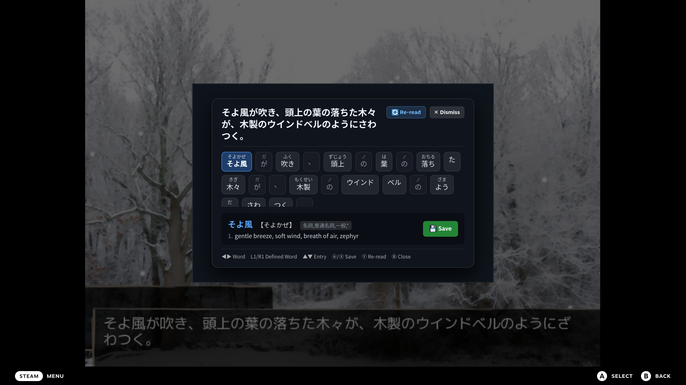

# Decky Yomi

A Decky Loader plugin for reading Japanese text in games on the Steam Deck.

When you are playing a game or visual novel in Gaming Mode, hold `L4` (or another mapped button) to capture the screen, run local OCR, break the sentence into words, and look up definitions in an on-screen overlay without leaving the game.

## Screenshots

| In-Game Overlay (Katawa Shoujo) | Dialogue Region Capture |
| --- | --- |
|  |  |

## Features

- **Local OCR**: Uses [MeikiOCR](https://github.com/rtr46/meikiocr) (ONNX) by default for fast game and visual novel text recognition, with [manga-ocr](https://github.com/kha-white/manga-ocr) available as a fallback option for vertical manga-style text.
- **In-game overlay**: Displays the recognized sentence, furigana readings, and dictionary definitions over the game in a modal so button presses stay in the overlay until you close it.
- **Controller shortcut and navigation**: Hold `L4` (configurable to `R4`, `L5`, `R5`, or `Select`) to read the current screen, then use the D-Pad (`Left`/`Right` for words, `Up`/`Down` for dictionary entries), `L1`/`R1` to jump between defined words, `A`/`X` to save a word, `Y` to re-read, and `B` to close.
- **Region presets and visual guide**: Pick `Bottom 30%`, `Bottom 40%`, `Center`, `Full Screen`, or dial in a `Custom Region` with percentage sliders and on-screen alignment guide lines.
- **Word segmentation and dictionaries**: Uses MeCab (`fugashi` + `unidic-lite`) with `jamdict` (JMDict + KANJIDIC2), plus support for importing custom Yomitan `.zip` dictionaries.
- **Vocabulary list**: Save words to a local SQLite database and export them as `.tsv` for Anki.

## Requirements

- Steam Deck running SteamOS (`x86_64`) or ARM64 Linux (`aarch64`, tested on DroidDeck / Ubuntu 26.04) with [Decky Loader](https://github.com/SteamDeckHomebrew/decky-loader)
- `gst-launch-1.0` (PipeWire) and `ffmpeg` (included on SteamOS)

### ARM64 / DroidDeck Support

Decky Yomi also supports ARM64 Linux devices such as DroidDeck:

- **PyTorch & dependencies**: The installer automatically picks CPU-only `aarch64` PyTorch wheels, falls back to `venv --without-pip` + `get-pip.py` when `ensurepip` is unavailable, and skips optional `evdev` if `gcc`/`linux/input.h` are not installed.
- **Controller input**: When no `/dev/hidraw*` Steam Deck device is present, the controller monitor reads DroidDeck's `RBIF`/`IMU1` shared-memory input ring for `L4`/`R4` and D-Pad shortcuts.
- **Paths & permissions**: Helper scripts resolve `~/homebrew` dynamically and only wrap capture commands with `runuser -u deck` when the `deck` user exists.

## Installation

### From a release ZIP

1. Download `decky-yomi-0.1.10.zip` from the Releases page.
2. In Gaming Mode, open **Decky -> Settings -> Developer** and enable Developer Mode if needed.
3. Choose **Install Plugin from ZIP** and select the downloaded archive.
4. Open **Decky Yomi -> Setup** in the Quick Access Menu and run the one-click downloader to install the Python packages and models into `~/homebrew/settings/decky-yomi/`.

### From source

```bash
npm install
npm run build
./scripts/deploy.sh
sudo systemctl restart plugin_loader
```

If you want to pre-install Python dependencies manually before deploying, run `./backend/install_deps.sh`.

## Controls in Overlay

- **D-Pad Left / Right**: Move between words
- **L1 / R1**: Jump to previous / next word with a dictionary match
- **D-Pad Up / Down**: Browse dictionary entries for the selected expression and its word parts
- **A / X**: Save the displayed dictionary headword, reading, and meaning with the original sentence
- **Y**: Re-capture and re-read
- **B** (or hold `L4`): Close overlay

The overlay groups expressions such as 気をつけて and inflections such as 行った. The reading above each group follows the text on screen. Its dictionary entry shows the base form, such as 行く【いく】. To fix a recognition error, open the OCR tab, edit the captured text, and choose **Look up text**.

Yomitan imports support term banks with plain or structured definitions. Structured definitions are displayed and exported as text. The import result lists skipped bank types, including frequency and pitch metadata.

## Development and Testing

- `scripts/deploy.sh` builds `dist/` and copies runtime files straight into `~/homebrew/plugins/decky-yomi/`.
- `scripts/test_ocr.py` tests OCR against a saved screenshot (defaults to `~/homebrew/settings/decky-yomi/capture.png`).
- `scripts/gamemode_e2e.py` captures and logs a test run under `test_runs/` while in Gaming Mode.
- Run backend unit tests with:

```bash
PYTHONPATH=~/homebrew/settings/decky-yomi/py_modules /usr/bin/python3 -m unittest discover -s tests
```

## Architecture

See [ARCHITECTURE.md](ARCHITECTURE.md) for the high-level system diagram, capture/OCR sequence flow, frontend/backend module breakdown, HID protocol details, and SQLite schemas.

## License

[GPL-3.0](LICENSE)
